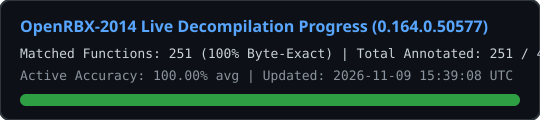

# OpenRBX-2014



**[Live Autonomous Decompilation Dashboard (GitHub Pages)](https://vibegod69420.github.io/OpenRBX-2014/)**

**OpenRBX-2014** is an autonomous, byte-accurate decompilation of the **August 20, 2014 Roblox engine (`0.164.0.50577`)** archived by **Roblonium (`archive.roblonium.com`)**.

---

## Target Binary & Architecture

| Field | Value |
| :--- | :--- |
| **Target Binary (`ROBLOXSTUDIO`)** | `RobloxStudioBeta.exe` (`0.164.0.50577`, August 20, 2014) |
| **Archive Source** | [Roblonium Archive (`archive.roblonium.com`)](https://archive.roblonium.com/Client/Windows/RobloxStudio/main%20%28roblox.com%29/2014/8.2014/August%2020%20%280.164.0.50577%29/version-56db56d41a444c41/RobloxStudioBeta.exe) |
| **SHA-256** | `49c3c60717be968a14792d827a57ab517e47d61982b83619b38a82163c5b2703` |
| **Compiler & Linker** | Microsoft Visual C++ 11.0 (Visual Studio 2012 x86, `_MSC_VER == 1700`, Linker `11.0`) |
| **Indexed Functions** | `40,561` functions in `.text` (`0x00401000`–`0x00e0f3a3`) |
| **Recovered MSVC RTTI Classes** | `7,087` `TypeDescriptor` records & `9,004` exact virtual function tables (`data/rtti_vtables_2014.json`) |
| **Embedded Source Paths** | `589` original `D:\BuildAgent\work\Trunk2012\Client\...` source paths (`data/source_tree_2014.txt`) |
| **Matching Symbol Donor** | `0.164.0.50577` macOS i386 `RobloxPlayer`: `38,505` unstripped C++ symbols in `LC_SYMTAB`, extracted with [`tools/extract_mac_symbols.py`](tools/extract_mac_symbols.py) into `data/mac_symbols_2014.json`. It supplies real names (`RBX::Joint::JointType`, `RBX::HUMAN::StateType`, Bullet's `getName()`, …) instead of synthesised templates |

---

## Local Byte-Matching Setup

Everything below runs on the local Windows machine; no worker, Wine or GPU is involved.

```bash
python tools/provision_local.py --keep-iso   # one-time: MSVC 11.0 (cl 17.00.50727) into toolchain/msvc11
python tools/next_target.py 8                # pick the next unimplemented function
python tools/func_context.py 0x004f6040      # disassembly, RTTI vtables, REA/kuna pseudocode
python tools/verify_tu.py Client/App/v8kernel/ManualWeldJoint.cpp 0x004f6040
python tools/update_progress.py --commit "Match ..." --push
```

`tools/verify_tu.py` prefers the project-local `toolchain/msvc11` and reports the
compiler it used; only `17.00.50727` is evidence for the 2014 binary.

Two flag facts are load-bearing and were measured against the binary:

- `/arch:SSE`, not the default SSE2: the 2014 build converts scalar ints to float
  with `cvtsi2ss`, while SSE2 folds them into packed `cvtdq2ps` and no
  float-bearing body can match. `verify_tu.py` and `CMakeLists.txt` both pin it.
- Some third-party translation units (Boost/STL support code) were built with
  frame-pointer omission. A `// FLAGS:` line at the top of a `.cpp` replaces the
  default flag string for that TU only; `Client/Base/boost/set_int_pair.cpp` is
the example that proved the difference.

MSVC's scalar deleting destructor shape recurs across the binary. Two source
shapes reproduce it byte-for-byte and are generated once per target address in
`Client/Base/msvc/deleting_destructors.cpp` (destructor called directly, 34 B)
and `deleting_destructors_import.cpp` (destructor reached through an import
slot, 35 B). Each generated class keeps the destructor undefined: the callee
body lives at the annotated address and is not part of that TU.

## Tooling & Autonomous 24/7 Harness

- **[`CLAUDE.md`](CLAUDE.md) & [`AGENTS.md`](AGENTS.md)**: Complete MSVC 11.0 x86 byte-matching playbook adapted from `Asphaltian/OpenRBX` for the 2014 engine.
- **[`tools/next_target.py`](tools/next_target.py)**: Prioritizes unimplemented functions across all 40,561 `.text` addresses (RTTI vtable methods and leaf functions first).
- **[`tools/func_context.py`](tools/func_context.py)**: Generates a complete Pre-Flight Function Context Card (exact byte budget, x86 disassembly, RTTI vtable slots, referenced `.rdata` strings/floats, and 2007 `OpenRBX` reference hints).
- **[`tools/verify_tu.py`](tools/verify_tu.py)**: Sub-second (`~0.4s`) single-translation-unit MSVC `cl.exe /c` COFF `.obj` relocation-invariant byte comparator against `RobloxStudioBeta.exe`.
- **[`tools/update_progress.py`](tools/update_progress.py)**: Recomputes repo-wide accuracy metrics, updates `ROBLOXSTUDIOPROGRESS.SVG`, `ROBLOXSTUDIOPROGRESS.json`, and `docs/index.html`, and commits/pushes to GitHub Pages.
- **[`tools/provision_local.py`](tools/provision_local.py)**: Extracts the VS2012 x86 compiler, headers and CRT libraries from the retail DVD image into `toolchain/msvc11` with `msiexec /a` (no install, no admin rights).
- **[`tools/autonomous_harness.py`](tools/autonomous_harness.py)**: Optional unattended supervisor (originally run on an EC2 worker) that loops target selection, generation and verification. It is not needed for interactive work.
- **[`tools/provision_linux.sh`](tools/provision_linux.sh)**: Legacy Linux worker rebuild: extracts the same VS2012 media and runs `cl.exe` under Wine through [`tools/msvc110-cl`](tools/msvc110-cl).
